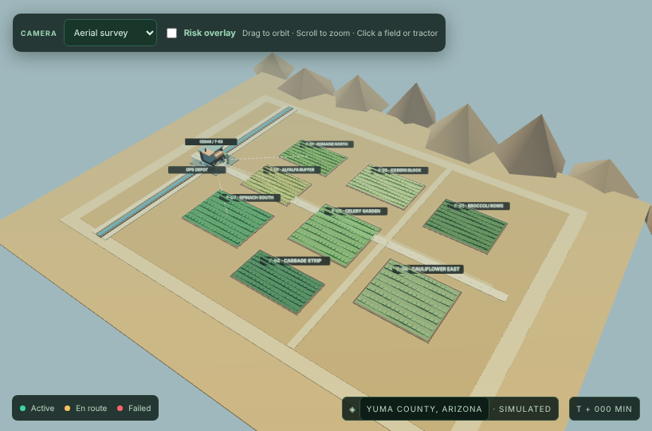

# FieldMarshal 2.0 — Regional 3D Fleet Orchestration

**AGX HackDay 2026 · Run the Fleet · Presented by American Tractor Company (ATC)**

**[Try the live application](https://fieldmarshal-agx.vercel.app/)**  
**Source:** this folder. **Single-file deploy build:** `dist/index.html` (also shipped as `FieldMarshal-3D-Deploy.html`). **Demo video:** [Record of the live scenario](demo/FieldMarshal-demo.mp4).

FieldMarshal is an event-driven, explainable fleet coordinator over a **real 3D WebGL digital twin**. It schedules compatible jobs across three simulated agricultural tractors, accounts for fuel, travel time and deadlines, handles machine failures and road blockages, protects completed work, and reports its behavior against a first-come-first-served baseline. The digital twin is an interactive operational visualization driven by the same simulation state, not a separate animation.



> **Reproducibility:** This is a software simulation with synthetic farms and invented telemetry. The latest source-package benchmark replaces any earlier figures circulated in presentation drafts. Under the final incident schedule, modeled travel decreases by approximately **16.3% (Yuma)** and **10.5% (Pinal)**; job-completion and on-time results are mixed, as documented below.

## Start the demo

```bash
cd fieldmarshal
python3 -m http.server 8080      # any static server works
# open http://localhost:8080
```

No CDN, backend, account or token is needed. Three.js r170 is vendored in `vendor/three/` (MIT, licence included), so the 3D view also works offline and behind restrictive networks. `dist/index.html` is the same app as one self-contained file (≈620 KB) for static hosting. Rebuild it with the esbuild command in **Deploy** below.

```bash
node --test tests/engine.test.mjs          # 13 engine tests
node src/run-demo.mjs                      # regenerates artifacts/ + prints the benchmark table
python3 tests/browser/e2e.py http://localhost:8080/   # 18 real-browser WebGL checks (Playwright + Chrome)
```

## One-click judge demo (≈90 s; recorded in `demo/FieldMarshal-demo.mp4`)

1. Open the app. **Yuma Valley · Winter greens** loads in **Live 3D** and the badge reads `3D engine ready` once the first WebGL frame has rendered. Drag to orbit, scroll to zoom, and switch cameras (Aerial / Cinematic / Operator).
2. Press **Run simulation** for a few seconds, then click a tractor. The inspector shows its implement, fuel, current job and the dispatcher's plain-language **WHY**.
3. Switch to **Pinal Basin · Cotton & forage** and click **Run incident demo**. It replays the scenario's own `incidents` schedule, the same one the benchmark uses:
   - **T+22** Atlas (T-01) breaks down mid-job. J-03 returns to the queue with its 46% progress kept, and a compatible tractor finishes it.
   - **T+50** the field road F-01↔F-02 closes under Cedar's active trip. Only that trip is rerouted (F-01 → F-08 → F-02), and the job stays with Cedar.
   - **T+85** J-01 is escalated to priority 5 and idle tractors are re-scored. No field work is abandoned.
4. Scroll to **Optimizer vs first-come-first-served**. It re-runs both policies live on the same events.
5. **Export evidence** saves the scenario, full event log, final state, injected events and benchmark as JSON.

## Regional grounding and explicitly modeled inputs

The user-selectable scenarios are representative **synthetic farms**, not real geolocated farms or customer/farm data.

| Preset | Region + season | Regionally grounded crops | Illustrative scope |
|---|---|---|---|
| `scenarios/yuma-winter.json` | Yuma County, Arizona · November–March | Romaine, iceberg, broccoli, spinach, celery, cauliflower, cabbage, alfalfa | 3 tractors, 8 fields, 10 jobs, 180 sim min |
| `scenarios/pinal-fall.json` | Pinal County, Arizona · autumn | Cotton, alfalfa, silage corn, durum wheat, barley | 3 tractors, 8 fields, 10 jobs, 180 sim min |

**Crop-source evidence:** University of Arizona Cooperative Extension, *Economic Contribution of Yuma County Agriculture* (2025), https://extension.arizona.edu/sites/default/files/2025-02/Economic-Contribution-of-Yuma-County-Agriculture-Report.pdf ; and University of Arizona Cooperative Extension, *2025 Agricultural Interest Survey in Pinal County*, https://extension.arizona.edu/publication/2025-agricultural-interest-survey-pinal-county-arizona-stakeholder-priorities-extension .

**Synthetic assumptions, visibly labeled:** approximate region marker is NOT a field coordinate; all rectangular fields and roads are invented for an 8-field demo. Modeled air temperature, wind, soil moisture, machine speeds, fuel consumption and job durations are illustrative, NOT live data or calibrated operating recommendations. Farm grid = 100 × 72 units; the metric conversion is *12 meters per unit* solely for the synthetic scenario, not verified GPS distance. The simulation is not forecasting actual irrigation, pesticide application or crop treatment.

## Real 3D visualization (verified in a real browser)

`src/twin3d.mjs` builds original Three.js meshes: terrain, stylized mountains, field beds with 1,088 instanced crop-row segments, an irrigation canal with levees, field roads, the depot, and three tractors with cab, wheels and implement (spray boom or mower deck). Status rings, floating labels and dashed live-route lines are drawn from engine state. OrbitControls handles orbit, pan and zoom, and raycasting handles object selection.

**Motion is driven by the simulation.** Each tick, `update()` sets every tractor's target to the engine's `(x, y)`. The render loop eases the mesh toward that target, turns it to face its direction of travel and spins the wheels. The browser test checks that 3D targets equal engine positions exactly (drift = 0) in both regions during the incident run.

**Verified, not assumed** (`tests/browser/e2e.py`, results in `artifacts/screenshots/e2e-results.json`). Chrome 1xx headless with WebGL2 on ANGLE/SwiftShader:
- `3D engine ready` is set only after the first frame, and `readPixels` of the drawing buffer returns 108 distinct colours, so it is not blank
- the scene holds 8 fields, 3 tractors and 1,088 crop instances
- orbit drag moves the camera and scroll zoom changes the distance
- a raycast click on T-02 opens its inspector with the WHY explanation
- tractor meshes move after a tick
- the full incident run completes in 3D for both Yuma and Pinal with 0 violations and 0 page errors
- the risk overlay and the Tactical 2D toggle work
- with WebGL disabled, the app falls back to 2D and simulation and breakdown still work

The single-file `dist/index.html` passes the same 18/18.

The 3D renderer is a visualization, not a vehicle-dynamics, collision or soil simulator.

## Coordinator architecture

- **Fleet scheduler:** deterministic greedy assignment after capability, fuel and route feasibility checks. Scores job priority, a deadline-feasible bonus, travel time and field-work time; overdue jobs are not penalised (so they are not deferred). The rationale for each assignment is logged. It is a heuristic, not a globally optimal solver.
- **Navigation module:** Dijkstra shortest paths over simulated depot and field nodes; a closure reroutes only trips that use the closed segment. Road layout is schematic.
- **Safety module:** unique job-to-tractor allocation; no assignment to failed or incompatible machines; energy feasibility + reserve; completed jobs remain done; partial progress is preserved on breakdown or interruption. The `check()` invariants are audited every simulated minute and counted in the metrics.
- **Event sourcing:** every assignment, arrival, completion, failure, repair, route disruption and priority change has an event timestamp. Operators can export current state plus full log.
- **Controls:** step/run/pause/reset, import custom JSON configuration, guided incident demo, deliberate breakdown/repair, road block/clear, and priority changes.

## Reproducible comparison

Both policies run in the same engine on the same scenario file, the same injected `incidents` (breakdown T+22, road closure T+50, priority escalation T+85) and the same 180-minute horizon. FCFS takes jobs in submitted order but obeys the same compatibility, fuel-reserve and routing rules. Regenerate with `node src/run-demo.mjs`. Full definitions are in `artifacts/baseline-comparison.json`.

**With incidents** (the demo schedule):

| Region | Policy | Jobs done | On time | Late-min | Travel km | Idle t-min | Idle while work waited | Violations | Lost / duplicated work | Unfinished |
|---|---|---:|---:|---:|---:|---:|---:|---:|---:|---|
| Yuma | FCFS | 9 | **7** | **87** | 4.18 | 40 | 0 | 0 | 0 / 0 | J-10 |
| Yuma | FieldMarshal | 9 | 6 | 90 | **3.50** | 74 | 0 | 0 | 0 / 0 | J-06 |
| Pinal | FCFS | 9 | 6 | **50** | 4.68 | 16 | 0 | 0 | 0 / 0 | J-10 |
| Pinal | FieldMarshal | **10** | **7** | 73 | **4.19** | 32 | 0 | 0 | 0 / 0 | – |

**Without incidents:**

| Region | Policy | Jobs done | On time | Late-min | Travel km | Idle t-min |
|---|---|---:|---:|---:|---:|---:|
| Yuma | FCFS | 10 | **10** | **0** | 4.58 | 171 |
| Yuma | FieldMarshal | 10 | 9 | 18 | **2.72** | 261 |
| Pinal | FCFS | 10 | 10 | 0 | 5.00 | 152 |
| Pinal | FieldMarshal | 10 | 10 | 0 | **3.71** | 219 |

**Honest reading.**
- FieldMarshal's consistent win is travel: 10–41% less modeled distance in every case.
- On jobs and deadlines the result is mixed. Pinal with incidents is better (one more job done, one more on time). Yuma is one on-time job worse in both conditions.
- Higher total idle does not mean worse dispatch. FieldMarshal finishes work sooner and then waits, and "idle while work waited" is 0 for both policies.
- Both policies show 0 invariant violations (checked every simulated minute), 0 duplicated assignments and 0 lost progress.
- Recovery: Pinal shows 1 in-place reroute. In Yuma the T+85 escalation pre-empted one tractor that was still driving, which cost 21.7 grid units of abandoned travel and no field work.
- These are synthetic results. No real-world savings are claimed.

## Tests

- `node --test tests/engine.test.mjs`: 13 passing (log in `artifacts/node-test-results.txt`). They cover:
  - config validation
  - unique, compatible assignments every tick
  - breakdown mid-job keeps partial progress and another compatible tractor finishes the job
  - no incompatible implements
  - road closure under an active trip reroutes in place without dropping the job
  - priority escalation is applied and logged
  - a failed tractor gets no work until repaired
  - deterministic replay
  - both regions × both policies run the full incident schedule with 0 violations, 0 duplicated minutes and 0 lost progress
- `python3 tests/browser/e2e.py <url>`: 18 passing on source and on `dist/` (see the 3D section).

## Fixes in this release (Nov 15, 2026)

1. **3D never rendered in any browser.** `twin3d.update()` read `state.config.depot`, but `engine.snapshot()` has no `config`. The first update threw and the app always fell back to 2D. The twin now uses the scenario it was given in `setScenario()`.
2. **CDN dependency removed.** Three.js r170 is vendored, so blocked or slow jsDelivr no longer breaks 3D.
3. **Tractors faced sideways or backwards and teleported each tick.** Heading is now computed for the model's forward axis, and motion eases toward the simulated position.
4. **The dispatcher deferred overdue work.** A −4 points per projected-late-minute term made late jobs ever later; a 46%-done priority-5 job waited 49 minutes after a breakdown. That term was removed. The deadline-feasible bonus and the travel and duration costs are unchanged.
5. **Road closure cancelled every trip in the fleet.** Now only trips whose remaining path uses the closed segment are rerouted, and they keep their job. Reopening a road no longer cancels trips.
6. **Priority change cancelled every trip in the fleet.** Now at most one compatible tractor that is still driving to lower-priority work is pre-empted, and it is assigned the escalated job directly.
7. **Violations were only checked at the end of a run.** They are now audited every simulated minute. Duplicated-assignment minutes, lost progress, idle-while-work-waited, late-minutes and abandoned travel are measured directly.
8. **The incident schedule was a no-op in parts.** The old priority change targeted an already-finished job, and the old road closure never touched a route. Each scenario now carries its own `incidents` schedule, which the UI demo, the benchmark and the tests all use.
9. **UI fixes.** The 3D HUD overlapped the region tag, labels were unreadable, the scene was over-exposed, and there was no favicon (a 404).

## Realism notes

- Yuma: romaine, iceberg, broccoli, spinach, celery, cauliflower, cabbage, alfalfa (winter vegetables). Pinal: cotton, alfalfa, silage corn, durum, barley.
- Implements: only sprayer-equipped tractors spray, only mower-equipped tractors mow (alfalfa and forage fields only), and every unit can scout or inspect.
- **Time is compressed.** At 12 m per grid unit, 1.55–1.8 units/min is about 1.1–1.3 km/h, well below real field-road speeds. Job durations of 9–22 minutes are also short for whole-field operations. Treat minutes as a relative scale. Distances are comparable between policies but are not real-world estimates.
- All field boundaries, coordinates, telemetry, fuel, moisture and weather are **synthetic** and labeled as such in the UI.

## Deploy

Static hosting; no build step is needed for the source tree.

```bash
# Option A: deploy the single-file build to the existing project
cd dist && vercel link --project fieldmarshal-agx && vercel --prod
# Option B: deploy the source tree (index.html + src/ + vendor/ + scenarios/)
vercel --prod
# Rebuild dist/index.html after source changes (manual equivalent of ./scripts/build-dist.sh):
npx esbuild@0.24.0 src/app.mjs --bundle --format=esm --minify \
  --alias:three/addons=./vendor/three/addons --alias:three=./vendor/three/three.module.min.js --outfile=/tmp/app.bundle.js
# or simply: ./scripts/build-dist.sh
```

## Files

- `index.html`, `src/app.mjs`, `src/style.css`: UI and controls
- `src/engine.mjs`: dispatcher, Dijkstra routing, recovery, per-minute audit, `runPolicy` / `compare`
- `src/twin3d.mjs`: Three.js / WebGL digital twin
- `vendor/three/`: pinned Three.js r170 (MIT)
- `scenarios/{yuma-winter,pinal-fall,demo}.json`: configurations, each with its `incidents` schedule
- `tests/engine.test.mjs`, `tests/browser/e2e.py`: engine and real-browser tests
- `tests/browser/record-demo.py`, `cut-video.py`: reproducible demo-video recording
- `artifacts/`: event logs for both policies and regions, `baseline-comparison.json`, `benchmark-table.txt`, test logs, screenshots
- `dist/index.html`: self-contained deploy build
- `demo/FieldMarshal-demo.mp4`: 81-second demo video

Developed independently using a custom simulator. **AgOpenWeb was not integrated.** Simulation only: never use it to control real vehicles.
